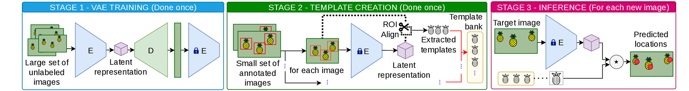

# Latent-Space Template Matching for Pineapple Detection in Drone Imagery

A variational autoencoder is trained without labels on the drone imagery of one
plantation. Templates are then extracted with RoIAlign at a small number of
annotated fruits on the encoder's feature map, correlated against whole images,
and reduced to counts by thresholding and peak suppression. No detector is
trained and no weight is updated after the first stage.



This repository holds the model, the experiment drivers, the SLURM scripts that
ran them, and the notebooks that reproduce every statistical result and figure
from the run logs.

## Installation

Tested with CUDA 12.8 and Python 3.10.

```bash
pip3 install -r requirements.txt
```

## Layout

| path | what it holds |
|---|---|
| `models/`, `losses/`, `experiments/` | the AE, VAE, β-VAE and VQ-VAE, their losses and training loops |
| `tools/` | RoIAlign template extraction, argument parsing, logging |
| `configs/` | training configurations |
| `prepare_experiment.py` | builds the partition and the template replicas |
| `prepare_baseline_experiment.py` | builds the bank and the bootstrap resamples of the held-out comparison |
| `run_optuna.py`, `run_grid_search.py`, `run_baseline_comparison.py` | the three experiment drivers |
| `slurms/` | the SLURM scripts that ran the campaign |
| `statical_analysis/` | the run logs and the notebooks that reproduce the results |

## Pipeline

Each step depends on the one before it. The SLURM scripts take their paths from
environment variables, so set them once:

```bash
export IMAGES_DIR=/data/datasets/FULL_UNIFIED
export LABELS_CSV=/data/datasets/labels_contents.csv
export CHECKPOINT=/work/VAE/checkpoints/betaKL@0.1/best.pt
export VAE_ENV=$HOME/envs/vae_env
```

### 0. Train the representation

Trains the VAE on the complete collection of aerial frames, every annotation
discarded. Only the encoder is kept afterwards; the decoder is dropped.

```bash
sbatch run_vae.slurm
```

Without SLURM:

```bash
python main.py --config ./configs/vae.yaml --model vae
```

### 1. Build the partition

Splits the annotated images into template, evaluation and test sets, stratified
by fruit-count quintile, and divides the template set into five disjoint folds,
one per replica. **Every later step reads the file this writes**, so nothing
runs before it.

```bash
sbatch slurms/run_prepare.slurm output/plan
```

Writes `output/plan/template_eval_folds.json` and `run_order.txt`.

### 2. Bound the design space

Multi-objective Bayesian search over the matching hyperparameters, on the
evaluation set. The number of trials and the output directory are arguments.

```bash
sbatch slurms/run_optuna.slurm 1000 output/optuna
```

Each trial is scored on one randomly drawn replica, so this run bounds the
space; it is not a performance result.

### 3. Run the factorial experiment

The 360 configurations of the grid, each on all five replicas, for 1,800 runs in
a randomized complete block design.

```bash
sbatch slurms/run_grid.slurm output/grid
```

### 4. Build the baseline plan

Fixes the single bank of 90 templates at the selected configuration and draws
the 1,000 bootstrap resamples of the test set, so all three methods are scored
on the same resample in every trial.

```bash
sbatch slurms/run_prepare_baselines.slurm output/plan_baselines
```

Writes `output/plan_baselines/baseline_plan.json`.

### 5. Run the held-out comparison

Scores the selected configuration, YOLOv8 and Grounding DINO on the 738-image
test set over the 1,000 paired trials.

```bash
export BASELINE_PLAN=output/plan_baselines/baseline_plan.json
sbatch slurms/run_baselines.slurm output/baselines
```

The original campaign split these trials across three jobs with `--resume_from`
and `--stop_at` to fit the queue's wall-clock limit:

```bash
python run_baseline_comparison.py --plan "$BASELINE_PLAN" --resume_from 0    --stop_at 1000 ...
python run_baseline_comparison.py --plan "$BASELINE_PLAN" --resume_from 1000 --stop_at 2000 ...
python run_baseline_comparison.py --plan "$BASELINE_PLAN" --resume_from 2000 ...
```

### 6. Reproduce the analysis

The notebooks in `statical_analysis/` take the run logs of steps 2, 3 and 5 and
reproduce every statistical result and figure. They need no GPU, no images and
no checkpoint.


